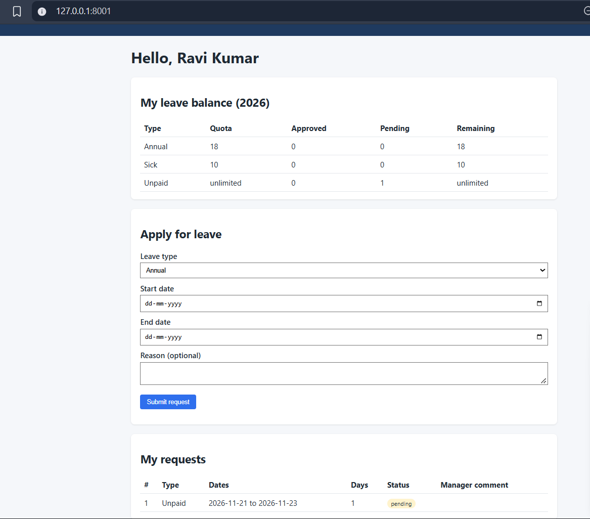
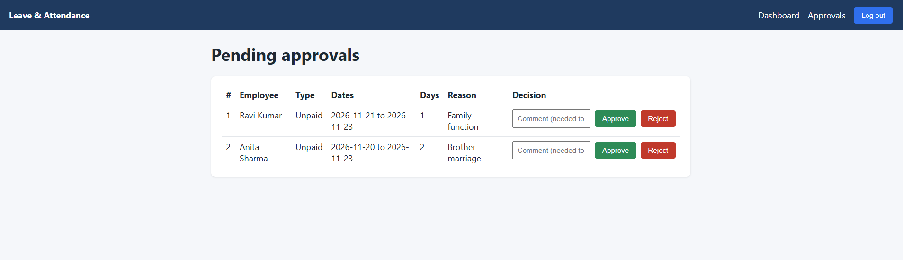

# Leave & Attendance Platform

[](https://github.com/samishaikk/Leave-Platform/actions/workflows/ci.yml)

A leave and attendance management system for an HR / Employee Success setting. Employees apply for leave and check in and out, managers approve or reject their team's requests, and SQL reports show balances, overlaps and attendance. The focus of the project is **correct business rules, SQL, and test automation**: the whole system is covered by unit, SQL, API and browser tests and runs in CI.

| Dashboard | Manager approvals |
|---|---|
|  |  |

## Features

- Login with JWT authentication; roles (employee, manager) control access
- Apply for leave (annual, sick, unpaid) with rules per type, working-day calculation (weekends and holidays excluded), balance tracking and overlap detection
- Managers approve or reject their direct reports' requests; every decision is written to an append-only audit log
- Attendance check-in and check-out, blocked on days of approved leave
- Holiday calendar synced from an external holiday service through a separate client class
- Four manager reports written in SQL (CTEs, joins, window functions)
- Server-rendered web pages (login, dashboard, approvals) plus a documented REST API at `/docs`
- `/health` (liveness) and `/ready` (readiness, checks the database) endpoints

## Tech stack

Python 3.12, FastAPI, SQLAlchemy 2, PostgreSQL 16, Pydantic v2, PyJWT, bcrypt, Jinja2, httpx, Pytest, pytest-cov, Playwright, Docker and Docker Compose, GitHub Actions.

## Architecture

```
 Browser (Jinja pages)            Playwright E2E tests
        |                                  |
        +----------------+-----------------+
                         v
              FastAPI app (one container)
   +--------------------------------------------------+
   | routers   auth, leave, approvals, attendance,    |
   |           holidays, reports, ui                  |
   | services  LeavePolicy classes, working-day calc, |
   |           balance                                |
   | queries   4 SQL report files                     |
   | clients   HolidayClient  (external service)      |
   +------------------------+-------------------------+
                            v
                  PostgreSQL 16 (Docker)
   employees, leave_types, leave_requests, attendance,
   holidays, audit_log
```

## Business rules

| Rule | Annual | Sick | Unpaid |
|---|---|---|---|
| Yearly quota (working days) | 18 | 10 | unlimited |
| Earliest start date | 3 days from today | up to 7 days in the past | today |
| Maximum per request | 10 working days | 5 working days | 30 working days |
| Uses balance | yes | yes | no |

Also: pending requests reserve balance, overlapping requests are refused (409), a request cannot span two calendar years, rejecting needs a comment, and a manager can only decide requests of their own direct reports (anyone else gets 404).

## Key design decisions

- **Atomic approvals.** A decision is one `UPDATE ... WHERE status = 'pending'`. If two managers act at the same moment only one changes a row; the other gets 409. The audit row is written in the same transaction. This avoids a read-then-write race without explicit locks.
- **Rules as classes.** `AnnualPolicy`, `SickPolicy` and `UnpaidPolicy` extend a `LeavePolicy` base class and only change their settings, so a new leave type is a small subclass.
- **UI and API share one code path.** The web pages call the same functions as the REST endpoints, so rules cannot drift between them.
- **Testable time.** "Today" and "now" come from dependencies, so tests control the clock instead of depending on the date they run.
- **SQL in `.sql` files.** The reports live in `app/queries/` and are tested against a real PostgreSQL database.
- **Database constraints.** Date order, positive days and one attendance row per employee per day are enforced in the database, not only in Python.

## API overview

| Area | Endpoints |
|---|---|
| Auth | `POST /auth/login`, `GET /auth/me` |
| Leave | `GET /leave-types`, `POST /leave-requests`, `GET /leave-requests/mine`, `GET /leave-balance` |
| Approvals (manager) | `GET /leave-requests/team`, `POST /leave-requests/{id}/decision` |
| Attendance | `POST /attendance/check-in`, `POST /attendance/check-out`, `GET /attendance/mine` |
| Holidays | `GET /holidays`, `POST /holidays/sync` (manager) |
| Reports (manager) | `/reports/team-balances`, `/reports/team-overlaps`, `/reports/team-calendar`, `/reports/monthly-attendance` |
| Ops | `GET /health`, `GET /ready` |
| Web pages | `/login`, `/`, `/approvals` |

Full interactive documentation is at `/docs` when the app is running.

## SQL reports

| Report | SQL techniques |
|---|---|
| Team leave balances | CTEs, `FILTER` aggregates, `CROSS JOIN` and `LEFT JOIN`, `COALESCE` |
| Overlapping leave in a team | self-join with a date-overlap condition |
| Team calendar | `generate_series`, `NOT EXISTS`, weekday filter |
| Monthly attendance summary | CTEs, `RANK()` window function, `NULLIF` |

## Testing

The test suite has more than 100 tests across five levels:

| Level | What it covers |
|---|---|
| Unit | policy classes, working-day calculator, holiday client (with a mocked HTTP transport) |
| SQL | each report query against a real PostgreSQL test database |
| API integration | auth, leave, approvals, attendance, holidays, reports (status codes, permissions, audit rows, conflicts) |
| Web pages | form flows through the FastAPI test client |
| End-to-end | Playwright browser tests using the Page Object pattern, run against a real server and its own database |

Techniques used: transaction rollback with savepoints so each test starts clean, factory helpers, parametrized cases, a fake clock, a mocked external holiday service, regression markers (`pytest -m regression`) and a coverage gate of 80% enforced in CI. One test (an invalid token returning 401 instead of crashing) is kept as a regression test for a bug found while building the project earlier.

## Run it

### With Docker (one command)

```bash
docker compose up --build
```

Open http://localhost:8001. The first start creates the tables and adds demo users.

| User | Role | Team |
|---|---|---|
| meera@example.com | manager | Ravi, Anita, Karan |
| suresh@example.com | manager | Divya |
| ravi@example.com, anita@example.com, karan@example.com | employee | Meera's team |
| divya@example.com | employee | Suresh's team |

All demo users have the password `Password123!` (it is just the demo data).

### Local development

```bash
python -m venv venv
venv\Scripts\activate            # Windows (use source venv/bin/activate on Linux/macOS)
pip install -r requirements.txt
docker compose up -d db          # PostgreSQL on port 5434
python -m app.seed               # tables and demo data
uvicorn app.main:app --reload --port 8001
```

### Run the tests

```bash
pytest -q                                          # unit, SQL, API and web page tests
pytest --cov=app --cov-report=term-missing         # with coverage
pytest -m regression                               # regression subset
playwright install chromium                        # once
pytest -m e2e                                      # browser tests
```

The tests use the `leave_test_db` database from the Compose setup (`TEST_DATABASE_URL` overrides it).

## CI

GitHub Actions runs on every push and pull request: a `tests` job (PostgreSQL service container, tests with the 80% coverage gate, Playwright browser tests, traces and screenshots uploaded on failure) and a `docker` job that builds the image, starts the Compose stack, waits for the health checks, calls `/ready` and logs in as a seeded user.

## Project structure

```
app/
  main.py            app setup, /health, /ready
  db.py, models.py, schemas.py, security.py, auth.py, clock.py
  routers/           auth, leave, approvals, attendance, holidays, reports, ui
  services/          policies.py, working_days.py, balance.py
  queries/           4 .sql report files and their runner
  clients/           holiday_client.py
  templates/         Jinja pages
tests/               unit, SQL, API, UI tests
tests/e2e/           Playwright tests and page objects
.github/workflows/   ci.yml
Dockerfile, docker-compose.yml
```

## Limitations

- The holiday service is **simulated**: without `HOLIDAY_API_URL` the client returns a small built-in calendar. The real HTTP path exists and is tested with a mocked transport, but it has not been run against a live provider.
- Demo users and their password are seeded for convenience. A real deployment would not do this.
- The web pages use a `SameSite=Lax` cookie without CSRF tokens and without the `Secure` flag, which is fine locally; a real deployment would add both.
- Tables are created with `create_all`; there is no migration tool (such as Alembic).
- Weekends are Saturday and Sunday, and there is a single timezone (the server's).
- Managers without a manager of their own cannot have their leave approved, because there is no approver above them.
- This service has health and readiness endpoints only. Metrics, dashboards and tracing are not part of this project.